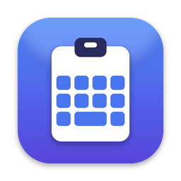
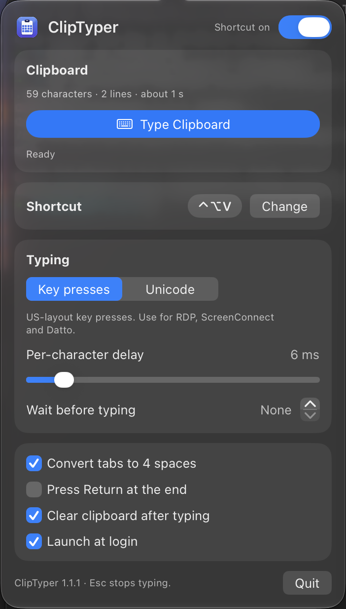

<p align="center">
  
</p>

<h1 align="center">ClipTyper</h1>

<p align="center">
  A macOS menu-bar app that types your clipboard as keystrokes.<br>
  For remote sessions where paste is blocked, truncated or unreliable.
</p>

<p align="center">
  
</p>

## What it is for

Remote-control tools often refuse to paste, or cut the paste short. ClipTyper works around
that: copy a script on the Mac, click into the remote window, press a shortcut, and the text
is typed in key by key as if you had typed it yourself.

Tested with:

- Windows App (Microsoft Remote Desktop / RDP)
- Datto RMM web remote
- ScreenConnect

## Features

- Global shortcut (default ⌃⌥V) that you can rebind to any key combination or a single F-key
- Small progress bar at the top of the screen while typing; **Esc** stops it
- Warnings before typing starts: Caps Lock on, characters that cannot be typed, very long text
- Menu-bar panel with an on/off switch, clipboard size, speed and mode controls
- Two typing modes:
  - **Key presses**: real US-layout key presses. This is the mode for RDP, ScreenConnect and Datto
  - **Unicode**: sends characters directly, in any language, for Mac apps and VNC
- Converts tabs to spaces, so Tab does not trigger autocomplete in PowerShell
- Replaces curly quotes and long dashes with their plain forms in Key presses mode
- Optional: clear the clipboard after typing, for passwords
- Launch at login
- No network access, and the clipboard text is never shown or stored

## Install

Requires macOS 13 or newer. Runs on Apple silicon and Intel Macs.

### Download

1. Download the zip from the [latest release](https://github.com/cutthroat361/ClipTyper/releases/latest) and unzip it.
2. Move `ClipTyper.app` to the Applications folder.
3. The app is not notarized by Apple, so run this once in Terminal:
   ```
   xattr -dr com.apple.quarantine /Applications/ClipTyper.app
   ```
4. Open ClipTyper.

### Build from source

Needs the Xcode Command Line Tools (`xcode-select --install`).

```
git clone https://github.com/cutthroat361/ClipTyper.git
cd ClipTyper
./setup-signing.sh
./build.sh
```

`setup-signing.sh` is a one-time step, explained under
[Keeping the permission across rebuilds](#keeping-the-permission-across-rebuilds).
`build.sh` compiles the app, installs it into `/Applications` and starts it.

### Permission

On first start, allow ClipTyper under **System Settings > Privacy & Security > Accessibility**.
macOS requires this permission for any app that presses keys for you.

## Use

1. Copy the text.
2. Click into the remote window (Notepad, PowerShell, a login field).
3. Press ⌃⌥V.

A small bar at the top of the screen shows the progress. Press **Esc**, press the shortcut
again, or click the menu-bar icon to stop.

Click the keyboard icon in the menu bar to change the shortcut, the speed or the mode.

### Warnings

If something looks wrong, ClipTyper does not start typing. It shows the reason at the top of
the screen and waits a few seconds: press the shortcut again to type anyway, or Esc to cancel.

| Warning | What it means |
| --- | --- |
| Caps Lock is on | Letters may arrive in the wrong case. |
| Characters will be skipped | The text has characters with no key on a US keyboard (Cyrillic, emoji, arrows). Key presses mode leaves them out. |
| Long text | Typing will take a minute or more. |

The same warnings appear in the panel. The **Type Clipboard** button there starts right away.

## Things to know

- **Remote keyboard layout must be English (US)** in Key presses mode. ClipTyper presses
  physical keys, and the remote machine decides which character each key produces.
- **Caps Lock on the remote machine** cannot be seen from the Mac. Only the Mac's own
  Caps Lock is checked.
- **Dropped characters on a slow link**: raise the per-character delay to 15–20 ms.
- **Editors that auto-indent or auto-close brackets** (PowerShell ISE, VS Code) will change
  typed code. Notepad and the console do not.
- **F-keys on a MacBook** only act as F-keys with Fn held, unless "Use F1, F2, etc. keys as
  standard function keys" is turned on in Keyboard settings.
- **The shortcut is global**: the combination you choose no longer reaches other apps or the
  remote session while ClipTyper is switched on. Esc is only taken over while ClipTyper is
  typing or showing a warning.

## Keeping the permission across rebuilds

macOS ties the Accessibility permission to the app's signing identity. Without a certificate
every build counts as a new app, and the permission has to be granted again each time.

Run this once:

```
./setup-signing.sh
```

It creates a self-signed certificate named `ClipTyper Local` in your login keychain. From
then on `build.sh` signs every build with it:

- During the next build macOS asks whether `codesign` may use the key. Enter your Mac login
  password and click **Always Allow**.
- Allow ClipTyper under Accessibility one last time. Later builds keep the permission.

If the script fails, the same certificate can be made by hand: **Keychain Access >
Certificate Assistant > Create a Certificate…**, name `ClipTyper Local`, identity type
Self-Signed Root, certificate type Code Signing.

Apps downloaded from the Releases page are not signed with your certificate, so updating
that way asks for the permission again.

## Build options

```
./build.sh               build, install into /Applications and start the app
./build.sh --zip         also write dist/ClipTyper-<version>.zip
./build.sh --no-install  build only; nothing on this Mac is changed
./build.sh --native      build for this Mac's processor only (faster, not for sharing)
```

The app is built as a universal binary, so one copy runs on Apple silicon and Intel.

## Releasing a new version

1. Change the number in the `VERSION` file and commit it.
2. On GitHub, open **Actions > Release > Run workflow**.

GitHub builds the universal app, creates the tag `v<version>` and publishes the release with
the zip attached. Pushing a tag named `v<version>` does the same.

Every push is also built and tested automatically (the **Build** workflow).

## Project layout

```
Sources/ClipTyper/
  main.swift             entry point
  AppDelegate.swift      menu-bar icon and the panel that opens from it
  AppModel.swift         settings, the shortcut, and the "type the clipboard" flow
  PanelView.swift        the panel's layout
  HUD.swift              the on-screen progress bar
  Typer.swift            posts the key events
  HotKeyCenter.swift     global shortcuts
  Shortcut.swift         shortcut model and its display name
  KeyMap.swift           which physical key produces which character
  TextPreparation.swift  text clean-up, pre-typing checks and estimates
Tests/ClipTyperTests/    unit tests for the key map and the text checks
Resources/AppIcon.icns   app icon
build.sh                 builds, signs and installs the app
setup-signing.sh         one-time signing certificate
VERSION                  version number
```

Run the tests with `swift test` (needs full Xcode, not only the Command Line Tools).

## Credits

Inspired by [ArbenP/TypeClipboard](https://github.com/ArbenP/TypeClipboard) for macOS and
[jlaundry/TypeClipboard](https://github.com/jlaundry/TypeClipboard) for Windows.
